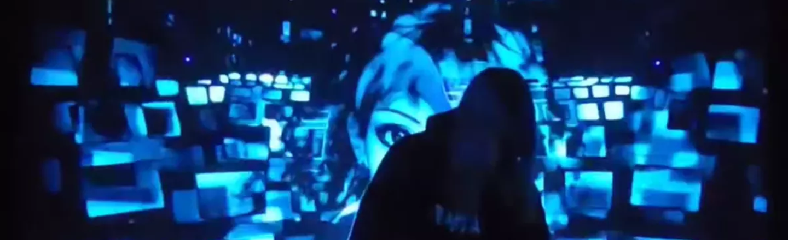

# PHASE(S) — BAKÛ Live A/V feat. Elisalien

> Dossier artistique web (une page) du live audiovisuel PHASE(S) de BAKÛ & Elisalien, avec sa note d'intention de résidence.

 

<p align="center"></p>

## À propos

Site statique d'une seule page présentant **PHASE(S)**, le live A/V de **BAKÛ** (musique & dessin) et **Elisalien** (visuels temps réel & régie vidéo), duo qui collabore depuis 2020. Le projet explore des thèmes autour des avatars et de l'introspection, en mêlant dessins, animations et captation live intégrée aux visuels (Resolume, Ableton Live).

La page contient deux onglets : le **dossier artistique** et la **note d'intention** rédigée pour l'appel à candidatures de la résidence Château Éphémère 2026–2027.

## Fonctionnalités

- **Dossier artistique** : concept, présentation du duo, clips & captation (YouTube), dates 2026 et dates passées, actualités & partenaires, contacts
- **Note d'intention** : pertinence du lieu, intention artistique, axes de la résidence (interaction son/vidéo via OSC, captation live, motion capture, spatialisation audio), état d'avancement
- Navigation par onglets et points de navigation latéraux (défilement fluide)

### Liens présents dans le dossier

- Clips : [Captation live](https://www.youtube.com/watch?v=JTdg_ErkeMM) · [I Miss You](https://www.youtube.com/watch?v=mOxxJZ2Y2p0) · [Runaway](https://www.youtube.com/watch?v=Jk-isFKsJ-0) · [MORT ROSE](https://www.youtube.com/watch?v=fyhRQCqgVD0) (3e place aux Chroma Awards) · [Night Walk](https://youtu.be/yhr_K0xO5zY)
- BAKÛ : [8raw](https://eight8raw.com/) · [YouTube](https://www.youtube.com/c/bak%C3%BBdub) · [SoundCloud](https://soundcloud.com/bakuphene) · [Instagram](https://www.instagram.com/baku.phene/)
- Elisalien : [elisalien.com](https://www.elisalien.com) · [Instagram](https://www.instagram.com/elisalien/)
- Partenaires : [ODG Prod](https://odgprod.com/artists/baku/) · [aftrwrk](https://aftrwrkprod.fr/artists/baku/) · [Collectif Neon Live](https://neon-live.fr/) · [AADN — Éclats d'Aura](https://www.aadn.org/annonce-des-laurates-clats-daura/)

## Installation

Le site est un simple `index.html` : il peut être ouvert directement dans un navigateur.

Pour le servir localement avec le serveur statique prévu dans `package.json` (Node.js requis) :

```bash
npm install
PORT=3000 npm start   # serve -s . -l $PORT
```

Le fichier [`nixpacks.toml`](nixpacks.toml) décrit le build (`npm install`) et le démarrage (`npm start`) pour un déploiement via Nixpacks.

## Structure du projet

```
.
├── index.html       # Page unique : dossier artistique + note d'intention (HTML, CSS et JS inline)
├── assets/          # Visuels du projet, photos des artistes, vignettes des clips
├── package.json     # Script de démarrage (serve)
└── nixpacks.toml    # Configuration de build/déploiement
```

## Stack technique

HTML, CSS, JavaScript (vanilla), Google Fonts (Orbitron, Share Tech Mono, Zen Kaku Gothic New), [serve](https://www.npmjs.com/package/serve).

## Crédits & licence

- Projet : BAKÛ & Elisalien
- Crédits photos & vidéo : Raphaël Pellet • Elisalien • Bakû • Oksana Brossard

Aucune licence n'est spécifiée — tous droits réservés.

---

<p align="center">
  Fait par <a href="https://github.com/elisalien">Élisalien</a> ·
  <a href="https://gitlab.com/elisalien/catalog">Catalogue des shaders, sources & logiciels</a>
</p>
